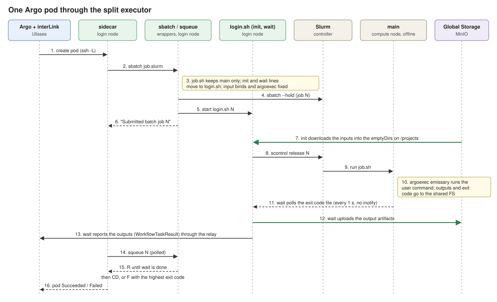
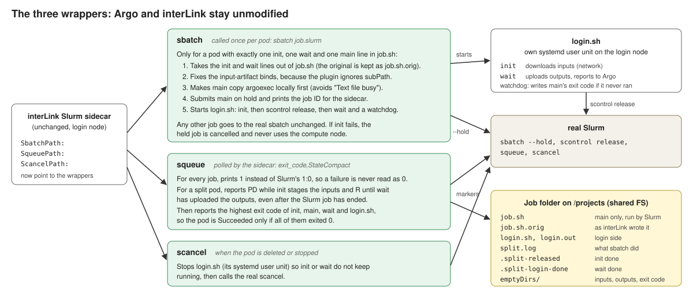

# Approach: plain Argo workflows on HPC compute nodes without network

## 1. The problem

On Deucalion, the login nodes reach the internet, but the compute nodes of the `normal-*` partitions do not. Anything that moves data between the Global Storage and the HPC side, or reports results to Kubernetes, therefore has to run where there is network, while the computation itself runs on a compute node. Scientists should still be able to write ordinary Argo workflows, with native artifacts, that would run on any Kubernetes cluster.

Two ways of doing this are implemented, called modes. `split` runs on Isabel's interLink 0.6.1 and is described in sections 2 to 6. `reverse` runs on interLink 0.6.3 and is described in section 7. Both run the same workflows and tests, and `deploy/deucalion/k8s-side.sh mode split|reverse` switches between them ([HOW_TO_RUN.md](HOW_TO_RUN.md)).

## 2. The idea

An Argo pod has three containers. `init` downloads the input artifacts, `main` runs the user's command, and `wait` uploads the output artifacts and reports to Kubernetes. Only `init` and `wait` need the network, and they talk to `main` only through files under `/var/run/argo` and the pod's emptyDirs. `wait` learns that `main` has ended by polling a file, not through file notifications, so this also works across two machines. The split executor therefore runs `init` and `wait` on the login node and only `main` on the compute node, with the shared file system (`/projects`) between them. Nothing in Argo or interLink is modified.

### 2.1 Compared with Isabel Moutinho's prototype

Both designs share the same base: Kubernetes, Argo and interLink on Ulisses, the interLink Slurm sidecar on a Deucalion login node reached through an `ssh -L` tunnel, and MinIO as the Global Storage. They differ in how data reaches the job and in what the scientist writes.

| | Isabel's prototype | Split executor |
|---|---|---|
| Workflows | Written with her sync modules and resource templates | Plain Argo workflows with native artifacts, unchanged |
| Data movement | A data wrapper (`sync-data.sh`), set as the sidecar's `CommandPrefix`, mirrors the data with `mc` around the job | Argo's own `init` and `wait` containers download and upload the artifacts on the login node |
| What runs in the Slurm job | The wrapper and the user's container | Only `main`, the user's container |
| Sidecar configuration | Real Slurm commands, `CommandPrefix` set to the wrapper | Three wrappers in place of `sbatch`, `squeue` and `scancel`, no `CommandPrefix` |
| Reporting to Kubernetes | The virtual kubelet reports the status of the pods of her Kubernetes Jobs | Through `wait`, with its API calls pulled by Ulisses over the relay |
| Container images | Pulled by the job (`docker://`) | Pulled beforehand on the login node |

## 3. How one pod runs

The interLink sidecar on the login node still receives the pod and still calls `sbatch`, `squeue` and `scancel`, but its configuration points those three commands to our wrappers. The `sbatch` wrapper keeps only `main` in the Slurm job and submits it on hold. It then starts `login.sh`, which runs `init` on the login node, releases the job once the inputs are staged, and runs `wait` while `main` runs on the compute node. `wait` sees `main`'s exit code file on the shared file system, uploads the outputs and reports them to Argo. The `squeue` wrapper keeps the pod running until `wait` is done and then reports the true result.

`wait` needs the Kubernetes API, but the Deucalion login node most likely cannot connect to Ulisses, which has a private FEUP address. The relay (`setup/hpc/split-executor/api-relay/`, one static Go binary) solves this without any change to the site network. `split-relay login` on the login node accepts the API calls of `init` and `wait`, and `split-relay agent` on Ulisses pulls those calls through an `ssh -L` tunnel that Ulisses opens, like interLink's own tunnel. The agent answers each call from the real API with the pod's own token. This works because Argo's executor makes only plain request and response calls, and no watches. If the API is reachable from the login node, the relay is not needed.

## 4. The three scripts

The three scripts live in `setup/hpc/split-executor/`. They replace the Slurm commands that the sidecar calls, which is the only place where the split can happen without forking Argo or interLink. The sidecar already lets you choose the path of each command (`SbatchPath`, `SqueuePath`, `ScancelPath` in `SlurmConfig.yaml`), so three lines of configuration put them in place. The real Slurm commands are recorded in `split.conf`.

### 4.1 `sbatch`

The sidecar turns every pod into one Slurm job that runs all of its containers on the compute node, where `init` and `wait` could not reach the Global Storage or the Kubernetes API. The wrapper is called once per pod with the path of `job.slurm`. If the generated `job.sh` contains exactly one `init`, one `wait` and one `main` line, it keeps a copy as `job.sh.orig` and removes the `init` and `wait` lines, so the Slurm job runs only `main`. It rewrites the bind mounts of the input artifacts, because the plugin ignores Kubernetes' `subPath`. It makes the compute node copy `argoexec` before `main` starts, replaces `job.sh` atomically and runs it with `/bin/bash`, because executing a file that another node has just written can fail with "Text file busy". It then submits the job with `sbatch --hold`, prints Slurm's answer for the sidecar, and starts `login.sh` in its own systemd user unit (or with `setsid`). `login.sh` runs `init`, then `scontrol release`, then `wait`, together with a watchdog that writes an exit code for `main` if the job ends without one, so `wait` never hangs.

The hold is what makes the order safe: the compute node is not used until the inputs are on the shared file system, and if `init` fails the held job is cancelled and never runs. Any other job goes to the real `sbatch` unchanged. The wrapper writes nothing to stderr unless the submission failed, because the sidecar treats any stderr output as a failure, so it logs to `split.log` in the job folder.

### 4.2 `squeue`

The sidecar decides whether a pod has finished by polling `squeue`. For a split pod, the Slurm job ends before the pod is really done, because `wait` still has to upload the outputs. Slurm 23.11 also prints exit codes as `1:0`, and the plugin 0.6.1 reads the `0` after the colon. The wrapper prints the exit code alone for every job (`1` instead of `1:0`). For a split pod, it reports `PD` while `init` stages the inputs and `R` until `login.sh` has finished, and then the highest exit code of `init`, `main`, `wait` and `login.sh`, so the pod is `Succeeded` only if all of them exited with 0. Without it, Kubernetes would mark the pod as finished before its outputs exist, and a failed step could be reported as a success.

### 4.3 `scancel`

When a pod is deleted or a workflow is stopped, the sidecar calls `scancel`, but part of a split pod runs outside Slurm, in `login.sh`. The wrapper stops the systemd unit of `login.sh`, removes the job from its registry and then calls the real `scancel`. Without it, `init` or `wait` would keep running on the login node after the pod is gone.

### 4.4 Other settings

Four more changes to `SlurmConfig.yaml` are needed. `CommandPrefix` is set to empty, which switches off the data wrapper. `--no-eval` is added to the Singularity options, because Apptainer otherwise evaluates every environment value a second time and corrupts Argo's `ARGO_TEMPLATE`; it needs Apptainer 1.1 or newer. `--contain` gives each container its own `/tmp`, as in Kubernetes. `ImagePrefix` points to images pulled beforehand on the login node, because the compute node cannot pull images. On Ulisses, the virtual kubelet gives offloaded containers the relay's address and certificate (`KubernetesApiAddr`, `KubernetesApiPort`, `KubernetesApiCaCrt`). Argo's `workflowDefaults` send the pods to the interLink node, so the workflows themselves say nothing about the HPC side. `deploy/deucalion/hpc-side.sh` and `k8s-side.sh` make all of these changes with a backup, and undo them.

The HPC side needs only bash, coreutils, grep, sed, awk, curl, openssl, Slurm, Apptainer and `systemd-run --user` (or `setsid`). It needs no Python, no jq, no administrator and no site network change.

## 5. Results

All results come from the testbed (`testbed/`), a small copy of Deucalion on Lima virtual machines with Slurm 23.11.4, Apptainer, a shared NFS file system, an offline compute node, and a login node that cannot connect to the Kubernetes side. The tests are TC00 (one step with an input and an output artifact) and Isabel's tests TC01 to TC10 rewritten as plain Argo workflows (`tests/argo-native/`), except TC08, which tests per-user isolation and is left for later. Every result is checked in Argo and in the Global Storage (`tests/argo-native/checks.tsv`).

| Run | Date | Result |
|---|---|---|
| `t1-20261018-005325` | 18 Oct 2026 | All tests pass, 30 of 30 checks (`make test-t1`) |
| `20261116-220707` | 16 Nov 2026 | All tests pass, 30 of 30 checks, through the Deucalion scripts (`deploy/deucalion`) with the testbed's settings, after the HPC side stopped needing Python and jq |

In both runs, `main` ran on the compute node for every pod and `init` and `wait` ran on the login node, with all API calls going through the relay. Each test took between 30 seconds and about 3 minutes, including simulations of 120 and 60 seconds in TC06 and TC10. The next step is the same procedure on Deucalion's `normal-x86` partition.

## 6. Known limits

Images must be listed and pulled by hand on the login node, so a workflow cannot yet name any image it likes. Only x86 partitions work, because `init` copies the login node's `argoexec` into the pod and Deucalion's login nodes are x86. All pipeline jobs share one Deucalion account, and each job folder keeps the artifact keys and the pod's service-account token until it is deleted. Every byte of data goes through the login node, and an intermediate artifact makes a round trip through the Global Storage even when the next step runs on the same file system. `init` and `wait` live on the login node for the whole job, so a reboot of that node loses running pods, and many parallel steps mean many processes there. The relay's ports listen on `127.0.0.1` of a shared login node, where other users could reach them. The wrappers depend on the exact job script of interLink 0.6.1, on `squeue`'s output format and on Slurm's `--hold`, so an upgrade could break them; reporting the `subPath` and `1:0` issues upstream and making the split a plugin feature would remove most of this coupling.

## 7. The reverse mode: interLink 0.6.3 without the split

CNES does not want to maintain wrapper scripts. interLink 0.6.3, released on 16 Nov 2026, adds a reverse tunnel to its SSH shadow (PR #577): a pod running on a compute node opens connections back into the cluster, to the Kubernetes API and the Global Storage, through the login node, using `srun --overlap` and an sshd started inside the job where the site allows nothing else. With it the standard Argo executor runs whole on the compute node, so the split is no longer needed. The Slurm plugin 0.6.3 also fixes the `1:0` false successes (#169), so the `squeue` wrapper is not needed either, and `scancel` has nothing left to stop.

### 7.1 How one pod runs

The plugin submits the whole pod as one Slurm job, with `init`, `main` and `wait` in it, as on any Kubernetes node. Before the containers start, the job starts a small relay (`python3`) that holds a loopback address for the pod and accepts only the job's user, and maps the names the pod asked for to that address in the containers' `/etc/hosts`. On Ulisses, interLink starts a shadow pod for the offloaded pod. The shadow logs in to the login node over SSH, finds the job with `squeue --me`, and runs `srun --overlap` into the job's allocation to start an sshd there as the job's user, over `srun`'s standard input and output. Through that sshd it binds each forward with `ssh -R` as a Unix socket in the pod's folder under `SocketDirRoot`, behind the relay, and connects each one to the real endpoint inside the cluster. Nothing on the compute node connects outwards, nothing is installed on the site, and the login node's sshd is never asked to forward.

### 7.2 What is configuration, and what is still ours

Almost everything is configuration:

- **Virtual kubelet:** `Network.SSH` with `Reverse` (`NodeExec: srun`, `Sshd: userspace`, the combination that needs neither SSH into compute nodes nor forwarding on the site's sshd), the SSH key as a Secret and the login node's host keys as a ConfigMap. The API address given to offloaded containers is `kubernetes.default.svc.cluster.local:6443`, because an unprivileged sshd cannot bind port 443.
- **Argo `workflowDefaults`:** the pod annotation `interlink.eu/reverse-forwards`, so the workflows stay plain Argo.
- **Slurm plugin:** `SocketDirRoot`, `CommandPrefix: ""` (Isabel's data wrapper off), `--no-eval --contain`, pre-pulled images (`ImagePrefix`), and a fixed node capacity (`ResourceScriptPath`), because the plugin otherwise reports the free memory it sees, which fell below one pod's request on the testbed.
- **Kubernetes:** the Global Storage under a Service name, because the tunnel maps names, not IP addresses.

One wrapper is still ours, `setup/hpc/subpath-fix/sbatch`. The plugin still ignores `subPath` on emptyDir volumes, which Argo uses for every input artifact. `experiments/reverse-tunnel/upstream/` has the plugin patch to propose, and once it is released no wrapper is left. `deploy/deucalion` makes all of these changes with a backup and undoes them (`k8s-side.sh mode reverse`, `restore`).

### 7.3 Results

The mode was first tried on the testbed with `experiments/reverse-tunnel/` (its README lists the three problems found and fixed), and then run with the Deucalion scripts on the testbed's settings, exactly as in [HOW_TO_RUN.md](HOW_TO_RUN.md) section 1.4. The same tests and checks are used as for `split` (section 5).

| Run | Date | Result |
|---|---|---|
| `20261117-011154`, `-022804`, `-024031` | 17 Nov 2026 | All tests pass across the three runs of the experiment, after its fixes |
| `20261117-215316-reverse` | 17 Nov 2026 | All tests pass in one run, 30 of 30 checks, through the Deucalion scripts (`k8s-side.sh mode reverse`) |

In this mode `init`, `main` and `wait` all run in the Slurm job on the offline compute node, so every artifact and every API call of these runs went through the tunnel; the job's log shows `interLink: reverse tunnel ready` before the containers start. Time per test, both through the Deucalion scripts on the testbed:

| Test | `split` (`20261116-220707`) | `reverse` (`20261117-215316-reverse`) |
|---|---|---|
| TC00 | 1m02s | 1m39s |
| TC01 | 0m34s | 1m26s |
| TC02 | 0m30s | 1m34s |
| TC03 | 0m34s | 1m30s |
| TC04 | 0m35s | 1m38s |
| TC05 | 1m21s | 4m26s |
| TC06 | 2m25s | 3m30s |
| TC07 | 1m31s | 5m28s |
| TC09 | 1m02s | 3m38s |
| TC10 | 3m07s | 7m37s |

`reverse` is slower because every pod waits for its tunnel before its containers start: the shadow pod starts, logs in, waits for the job to run and starts the sshd in it. That took about 80 seconds per pod on the testbed, so it adds about a minute to every step. On Deucalion the queue of `normal-x86` comes on top, in both modes.

### 7.4 Compared with `split`

| | `split` | `reverse` |
|---|---|---|
| interLink | 0.6.1 | 0.6.3 |
| Code we maintain | 3 wrappers + relay | 1 wrapper (subPath), until upstream |
| Where `init` and `wait` run | login node | compute node, in the job |
| What the site must allow | SSH to the login node | SSH to the login node, `srun --overlap` into one's own jobs, `python3` and `sshd` on the compute nodes |
| Data path | login node ↔ Global Storage | compute node ↔ Slurm ↔ login node ↔ shadow pod on Ulisses ↔ Global Storage |
| Time per pod (testbed) | about 30 s for a short step | about 1.5 min for a short step, mostly the tunnel |

### 7.5 Known limits

Every pod pays for its tunnel before it starts. The throughput of the `srun` carrier (Slurm's I/O forwarding) has not been measured with large artifacts yet. The shadow logs in with an SSH private key kept in a Secret, which interLink copies into every shadow namespace; interLink's documentation advises a key for the tunnel only, restricted on the site, and the trial scripts delete the Secret and its copies when the mode is switched off. The site must allow `srun --overlap` and have `python3` and `sshd` on the compute nodes. The Global Storage is reached through a Service name, so over HTTPS its certificate would have to be valid for that name (Isabel's MinIO uses plain HTTP). As in `split`, images must be pulled beforehand on the login node, and all jobs share one Deucalion account.

