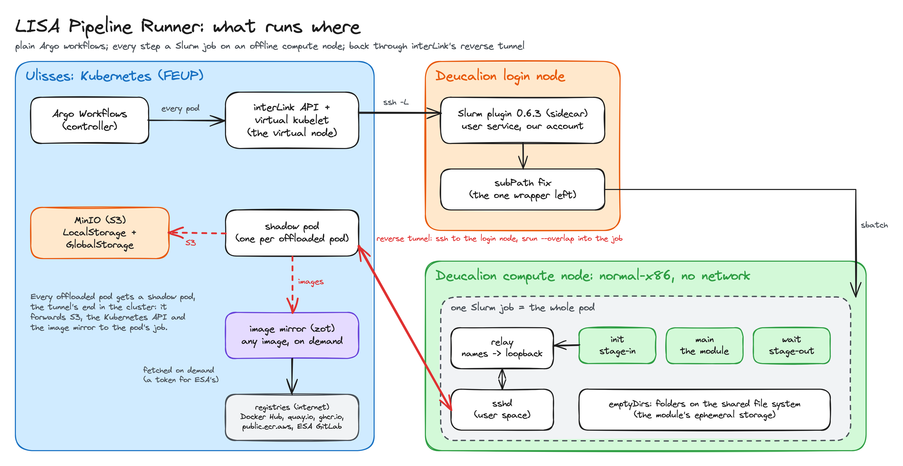
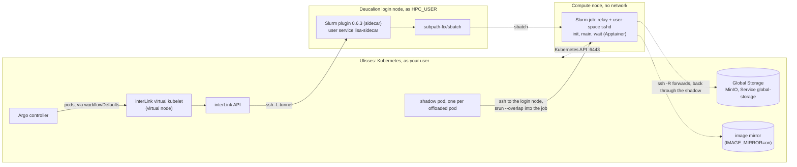
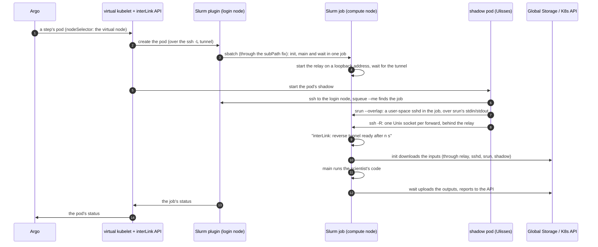
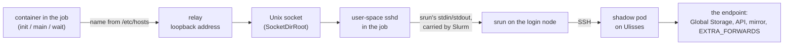
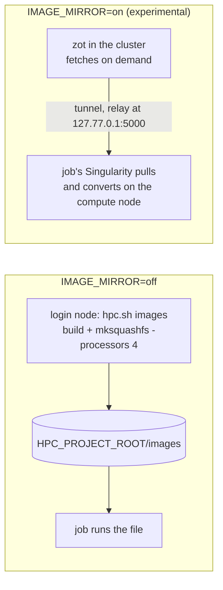
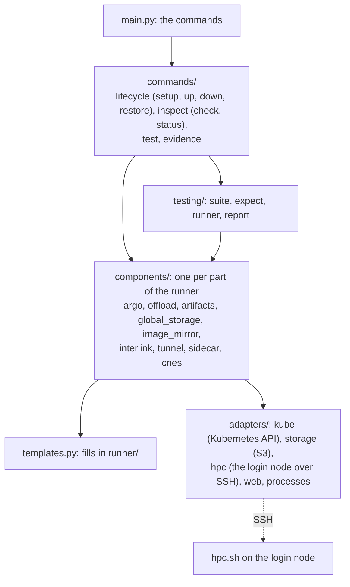

# Architecture: plain Argo workflows on HPC compute nodes without network

## 1. The problem

On Deucalion the login nodes reach the internet, but the compute nodes of the production partitions
(`normal-x86`, `normal-arm`, `large-arm`, GPU) cannot open any connection outside Deucalion. Deucalion's
staff confirmed this on 19 Nov 2026, and a probe job on `normal-x86` showed it.

- **What an Argo pod needs:** its containers must reach the Global Storage (S3) for their artifacts and
  the Kubernetes API to report back. `init` downloads the inputs, `main` runs the scientist's code, and
  `wait` uploads the outputs and reports.
- **What scientists should write:** ordinary Argo workflows with native artifacts, that would run on any
  Kubernetes cluster, with nothing specific to the HPC side.

## 2. The idea: interLink 0.6.3's reverse tunnel

interLink offloads a Kubernetes pod to Slurm. A virtual kubelet on the Kubernetes side passes the pod to
a plugin on the login node (the "sidecar"), which runs it as a Slurm job with Apptainer. interLink 0.6.3,
released on 16 Nov 2026, adds a reverse tunnel to its SSH shadow (interLink PR #577).

- **What the tunnel gives:** a pod running on a compute node opens connections back into the cluster,
  to the Kubernetes API, the Global Storage, or any service it names, through the login node.
- **What the site must allow:** SSH to the login node (interLink needs it anyway), `srun --overlap` into
  one's own jobs, and `python3` and `sshd` on the compute nodes.
- **The result:** Argo's standard executor runs whole on the compute node, as on any Kubernetes node.
  Neither Argo nor interLink is modified.

### 2.1 What runs where

- **Ulisses:** interLink's API and virtual kubelet, and the SSH tunnel to the sidecar, as three
  processes of yours (`<LISA_HOME>`, default `~/lisa-runner`), each restarted if it exits. They are not
  systemd services, which without root would stop at logout. Each person has their own virtual node,
  namespace and ports. Argo is installed once.
- **Deucalion:** the Slurm plugin as a user service. Without linger (Deucalion does not allow it), it
  runs while you have a session on the login node, and the tunnel from Ulisses is one.
- **The Global Storage:** an S3 endpoint Ulisses reaches, or a MinIO of ours in the cluster
  (`GS_ENDPOINT=cluster`). The jobs reach it through the tunnel either way.

### 2.2 How one pod runs

1. **The whole pod is one Slurm job,** with `init`, `main` and `wait` in it.
2. **A relay holds the pod's names.** Before the containers start, the job starts a small relay
   (`python3`) on a loopback address for the pod, accepting only the job's user. The names the pod
   asked for (the Global Storage's Service name, `kubernetes.default.svc.cluster.local`) are mapped to
   that address in the containers' `/etc/hosts`.
3. **The shadow pod reaches the job.** It logs in to the login node over SSH, finds the job with
   `squeue --me`, and runs `srun --overlap` into the job's allocation to start an `sshd` there, in user
   space. Slurm carries its standard streams between `srun` on the login node and `slurmstepd` on the
   compute node.
4. **The return paths open.** Through that `sshd`, the shadow binds each forward with `ssh -R` as a Unix
   socket in the pod's folder (the plugin's `SocketDirRoot`), behind the relay, and connects each to
   the real endpoint in the cluster.

So nothing on the compute node connects outwards, nothing is installed on the site, and the login
node's `sshd` is never asked to forward. The sockets live on the shared file system only because the
plugin creates their folder from the login node; Unix sockets are local to one node. What does go
through the shared file system is the plugin's usual bookkeeping: the job script, the containers'
settings, their output and exit codes, and the pod's emptyDirs.

### 2.3 The data path

All data goes through Slurm's I/O forwarding and SSH. Its throughput has not been measured yet
([open problems](open-problems.md)).

## 3. What is configuration, and what is ours

Almost everything is configuration of Argo, interLink and the Slurm plugin. It lives in `runner/`,
filled in from `settings/<site>.env` by `lisa`:

| File | What it sets, and why |
|---|---|
| `runner/cluster/interlink/VirtualKubeletConfig.yaml` | `Network.SSH` with `Reverse` (`NodeExec: srun`, `Sshd: userspace`): the combination that needs neither SSH into compute nodes nor forwarding by the site's `sshd`. The API at `kubernetes.default.svc.cluster.local:6443`, because an unprivileged relay cannot bind port 443 |
| `runner/cluster/interlink/InterLinkConfig.yaml` | interLink's API: a Unix socket to the virtual kubelet, the sidecar through the SSH tunnel's local port |
| `runner/cluster/interlink/shadow-credentials.yaml` | The SSH key the shadows log in with (a Secret) and the login node's pinned host keys (a ConfigMap) |
| `runner/cluster/workflow-defaults.yaml` | Argo's `workflowDefaults` while offload is on: every pod to the virtual node, the Slurm account and partition, and `interlink.eu/reverse-forwards`, what the tunnel carries. This is what keeps the workflows plain Argo |
| `runner/cluster/artifact-repository.yaml` | The Global Storage as the default artifact repository, under its Service name: the tunnel maps names, not IP addresses. In the key layout of CNES's PipelineRunner (their Helm chart), so their pipelines and common templates run unchanged: in their terms, our Global Storage is their LocalStorage, and their GlobalStorage is buckets `GS_GLOBAL_PREFIX*` on the same endpoint |
| `runner/cluster/platform-config-map.yaml` | What CNES's common templates read about the platform: image prefixes (`registry` empty, `registry_sys` the private registry as the image mirror serves it) |
| `runner/cluster/global-storage/` | That Service name, for a Global Storage outside the cluster (at an IP address or a host name). For trials, the tool can run a MinIO of its own under that name (`cli/manifests/minio.yaml`) |
| `runner/cluster/image-mirror.yaml` | The image mirror (section 4) |
| `runner/hpc/SlurmConfig.yaml` | The plugin: `SocketDirRoot`; `CommandPrefix: ""`; `--no-eval` (Apptainer would evaluate every environment value a second time and corrupt `ARGO_TEMPLATE`); `--contain` (a private `/tmp` per container, as in Kubernetes); `ImagePrefix`; a fixed node capacity (`resources.sh`: plugin 0.6.3 reports the free memory it sees, which fell below one pod's request and left pods `Pending`) |
| `runner/hpc/lisa-sidecar.service` | The plugin as a user service |

**One piece of code is ours on the HPC side:** `runner/hpc/subpath-fix/sbatch`, set as the plugin's
`sbatch`.
- **The gap:** the plugin ignores `subPath` on emptyDir volumes, and Argo mounts every input artifact
  that way (`input-artifacts`, `subPath: <artifact name>`). Without the fix, `main` finds a folder where
  it expects a file.
- **What it does:** it rewrites those binds in the job script, then calls the real `sbatch`.
- **No configuration avoids it:** Argo's controller hard-codes this mount.
- **The fix belongs in the plugin:** `upstream.patch` next to it, 9 lines with a unit test. The plugin's
  `main` still had the gap on 24 Nov 2026. Once a fix is released, no code of ours is left on the site.

## 4. Any image: the image mirror

Compute nodes cannot pull images. With `IMAGE_MIRROR=off` (the default), every image a pod names is
built beforehand on the login node (`IMAGES`). With `IMAGE_MIRROR=on`, a workflow names any image:

- **The mirror:** zot in the cluster, which fetches each image from its registry (Docker Hub, quay.io,
  ghcr.io, public.ecr.aws) and keeps it. Bare names go to Docker Hub, as Kubernetes reads them.
- **One private registry:** ESA's GitLab (`MIRROR_PRIVATE_REGISTRY`, default `gitlab.esa.int:4567`), which
  the mirror logs in to with a token of yours (`read_registry` only) kept in a Secret in the cluster; it
  never reaches the login node. Its images are named without the port (`gitlab.esa.int/<path>:<tag>`),
  because a name behind the mirror's own address cannot hold a second one. CNES's pipelines take their
  image prefixes from their `platform-config-map`, so that is platform configuration too.
- **Reached through the tunnel:** every pod gets a forward to it, and the plugin's `ImagePrefix` is
  `docker://127.77.0.1:5000/` (with `--no-https`).
- **Platform configuration, not the workflow's:** test TC12 names `busybox:1.37` and nothing else.
- **The cost of a fixed address.** Singularity pulls before the container exists, where the tunnel's
  names do not resolve, so every pod's relay takes the same address (`interlink.eu/reverse-bind`). Two
  pods must then not share a node: each asks for a whole node (`--exclusive`). And Slurm must end a
  job's relay with the job (`proctrack/cgroup`); under `proctrack/linuxproc` (the testbed's until 25 Nov
  2026) a finished job's relay held the address for the next job. Deucalion meets both: it uses
  `proctrack/cgroup`, and `normal-x86` gives every job a whole node anyway (`OverSubscribe=EXCLUSIVE`).
- **Each job then takes all of its node's memory.** Singularity converts a new image inside the job, and
  Slurm kills it at the job's memory, which the plugin takes from the pod's limit (TC13 on Deucalion:
  `OUT_OF_MEMORY` at 256Mi). So with the mirror the sidecar runs with `SBATCH_MEM_PER_NODE=0`: the pods'
  limits are requested, no longer enforced. On `normal-x86` the node is the job's anyway.
- **The clean fix is upstream:** interLink could set the image prefix to each pod's own relay address,
  which it already derives from the pod's UID. That removes the fixed address and `--exclusive`.
- **Status:** off by default until it has run on Deucalion. On the testbed it passed TC00 and TC12,
  and failed TC05 under `proctrack/linuxproc`; the testbed now uses `proctrack/cgroup`
  ([results](results.md)).

## 5. The tool

`lisa` (`cli/lisa/`, Python) is what puts `runner/` in place and tests it. It is not part of the runner:
it is how we deploy it as one user on a shared cluster (interLink as processes of ours, Argo installed
if missing, and from `cli/manifests/` a MinIO for trials and the tests' namespace), run the acceptance
suite, and collect evidence. A site would deploy `runner/` its own way ([open problems](open-problems.md),
next steps). It is organised so that only the adapters talk to the outside, and the rest reads as what
it does:

- **Kubernetes and Argo** through the API (the official Python client), not `kubectl` or `argo`.
- **The Global Storage** through S3 (`boto3`), not `mc`.
- **The login node** over SSH (`paramiko`). It has no Python, so what runs there is `cli/hpc.sh`, in
  bash. Its host keys are pinned on first contact, and every later connection, the shadows' too, is
  checked against them.
- **Dependencies** are pinned in `uv.lock`, and `uv` brings them without root.

**The tests** (`tests/NN-name/`) are plain Argo workflows, each with an `expect.yaml` saying what it must
produce. Every test is also checked for where it ran: each step pod was on the virtual node and is a
Slurm job in the partition, so no test passes on Argo's word alone. The tool's own tests
(`cli/tests/`, `make unit`) check that each test fails on a run that did not do its work.

## 6. Known limits

- **Every pod pays for its tunnel before it starts:** about a minute (68 to 84 s on the testbed).
- **Throughput not measured.** All data passes through Slurm's I/O forwarding and SSH.
- **The SSH key sits in Kubernetes.** The shadow logs in with a private key kept in a Secret, which
  interLink copies into every shadow namespace. interLink's documentation advises a key for the tunnel
  only, restricted on the site. `make restore` deletes the Secret and its copies.
- **Site requirements:** `srun --overlap`, `python3` (3.6 or newer; Deucalion has 3.6.8) and `sshd` on
  the compute nodes.
- **The 150-process limit.** Each running pod keeps an SSH session and an `srun` on the login node, where
  a user may run 150 processes and threads in all, the sidecar included.
- **HTTPS would need a matching certificate.** The Global Storage is reached through a Service name, so
  over HTTPS its certificate would have to be valid for that name (plain HTTP here).
- **Images:** built beforehand, or the image mirror with its costs (section 4).
- **An image must exist for the compute node's architecture.** Images built beforehand take the login
  node's (x86 on Deucalion); with the mirror, Singularity picks the compute node's platform from the
  image's index. So x86-only images, such as ESA's reference scanner (`linux/amd64` only), run on
  `normal-x86` but not on Deucalion's ARM partitions, nor on the testbed, whose VMs are `aarch64`
  (Apple Silicon).
- **One account per deployment.** All jobs share one Deucalion account, and job folders hold the pods'
  artifact keys and service-account tokens while they run.
- **Argo's `workflowDefaults` are global.** While offload is on, every workflow of that Argo goes to
  Deucalion.
- **The Slurm plugin's 0.6.3 release binary** panics on every pod deletion (a nil pointer that the tag's
  source already guards). The pod is deleted, but an empty job folder stays.
