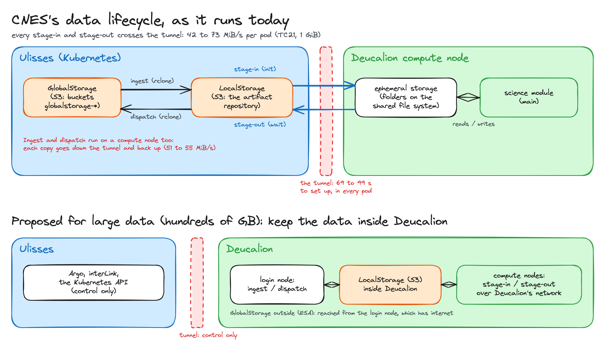

# Open problems, and what to do next

Where the work stands, for the next working session. Updated 25 Nov 2026. The why of every past change
is in the [CHANGELOG](CHANGELOG.md).

## Where it stands

Updated the evening of 25 Nov 2026.

- **The whole suite passes on Deucalion** with the restructured code: TC00 to TC11 (`20261125-114031`),
  every step a Slurm job on `normal-x86`, an offline partition, from Ulisses, as our own accounts.
- **Any image, through the image mirror, on Deucalion:** TC00, TC05 and TC12 (`20261125-132221`), and
  TC13, an image from ESA's private registry with a token (`20261125-150457`).
- **CNES's stress pipeline runs unchanged on Deucalion,** end to end with 1 GiB (TC21, `20261125-165404`):
  ingest from the GlobalStorage, a stress module, the final output, the dispatch back.
- **Measured on that run** ([results](results.md), "Through the tunnel"): the tunnel takes 69 to 99 s to
  come up in each pod, and carries 42 to 73 MiB/s for a pod's transfers. At 1 GiB the time is the
  per-pod overhead (13 of 27 minutes were tunnels coming up); at hundreds of GB it would be the bandwidth
  (500 GB is 2 to 3.5 hours each time it crosses the tunnel).

## Next steps, in order

1. **Keep the data inside Deucalion (for datasets of hundreds of GB).** Today every stage-in and
   stage-out crosses the tunnel, because the LocalStorage is on Ulisses. CNES's own data lifecycle puts
   the DCC's LocalStorage inside the DCC, next to the compute nodes. So: a LocalStorage (S3) inside
   Deucalion, reached by the compute nodes over Deucalion's network; the tunnel for control only (the
   Kubernetes API, status, logs); ingest and dispatch where both storages are reachable (the login node,
   which has internet). In Argo this is mostly configuration: the artifact repository's endpoint. To ask
   Deucalion's team (António):
   - an S3 endpoint inside Deucalion that compute nodes reach, or leave to run one (e.g. MinIO on
     Lustre), and where;
   - a `/projects` allocation (500 GB and more; `/home` is 25 GiB);
   - whether ingest and dispatch may run on the login node at these sizes (there are no transfer nodes).

   Write it up first as an architecture decision record, with the measurements.
2. **Less set-up per pod.** About 1.5 minutes of every step is the tunnel coming up, before any container
   starts. Find where it goes (the shadow pod's logs: waiting for the job, `srun --overlap`, `sshd`, the
   forwards), then:
   - propose to interLink what would shorten it (e.g. how often the shadow looks for the job);
   - a Slurm reservation during trials, so jobs do not wait in the queue;
   - longer term, a pilot job: one allocation kept for a workflow, its pods run inside it, one tunnel for
     all. It changes interLink's plugin and shadow (or brings back wrappers, which CNES does not want): a
     design study, worth a thesis section.
3. **Keep data movement in the cluster.** CNES's ingest and dispatch only copy between storages; with the
   LocalStorage on Ulisses they cross the tunnel twice for nothing (TC21's ingest: down and back up).
   Offload is all-or-nothing today: route per step (their system modules stay in the cluster, the science
   modules go to Deucalion), without changing their pipeline. Matches Bastien's model ("Ingest and
   dispatch cannot be performed on the compute nodes").
4. **Measure what is still unknown:**
   - several pods transferring at once (each has its own tunnel): TC21 with `nb-parallel-modules: 3`;
     also the login node's 150-process limit;
   - `obelix.h5` (10 GiB) with one module (about 11 GiB of the 25 GiB quota);
   - TC20 on Deucalion; Slurm's queue time apart from the tunnel (`sacct` against `where.tsv`).
5. **The full suite with the image mirror,** then decide whether it becomes the default.
6. **The subPath wrapper,** the last piece of our code on the site. The patch is ready with a unit test
   (`runner/hpc/subpath-fix/upstream.patch`); the plugin's `main` still had the gap on 24 Nov 2026, and
   nobody had reported it. (a) An issue and a PR on `interlink-hq/interlink-slurm-plugin`, the right end
   state, citable in the thesis; (b) the plugin built from tag 0.6.3 with the patch, which removes the
   wrapper now but makes us maintain a build. Not now (decided 25 Nov).
7. **A per-pod image prefix, proposed to interLink.** With the mirror, every pod's relay takes one fixed
   address, hence `--exclusive` and the `proctrack/cgroup` requirement. interLink already derives a relay
   address per pod from its UID (`reverseBindAddress`): an annotation such as
   `interlink.eu/reverse-image-mirror: host:port` could add the forward and set
   `slurm-job.vk.io/image-root` to `docker://<that pod's address>:<port>/`. The alternative, in the
   plugin: pull on the login node at submission (an image cache, a pull policy, the job held until the
   pull ends).
8. **The plugin's DeletePod panic,** reported upstream or built from the tag. The 0.6.3 release binary
   panics on every pod deletion (a nil `*JidStruct`), which the tag's source already guards: the binary
   does not match its tag, and an empty job folder is left per pod.
9. **Package the Kubernetes side as a site would deploy it.** The runner is `runner/` (README). On Ulisses
   we put it in place as one user: interLink's API, virtual kubelet and SSH tunnel run as our own
   processes, which stop when Ulisses reboots. A site like CNES would rather install it as everything
   else: interLink running in the cluster as Deployments, with the tunnel to the sidecar as a container
   beside it, the configuration as a Helm chart or Kustomize overlay rendered from `runner/cluster/`.
   With cluster-admin this can run on Ulisses too. Check first whether interLink's own Helm chart
   carries 0.6.3's reverse-tunnel settings.
10. **A message bus through the tunnel** (offered, not built): NATS in `ARGO_NAMESPACE`,
   `EXTRA_FORWARDS="nats.<namespace>.svc.cluster.local:4222"`, and a test where `main` publishes while it
   runs. The capability the split executor could not give.

## Open issues

- **Bastien's "second improvement" is the split executor.** His May proposal (Argo's `init` and `wait` on
  the login node) is what the tag `split-interlink-0.6.1` did (30 of 30 on the testbed), replaced by the
  reverse tunnel for no wrappers, standard Argo, and stream-in from `main`. Worth showing him, with the
  Deucalion results and the comparison with his data lifecycle.
- **interLink's logs hold secrets.** A pod that takes a secret into its environment (CNES's ingest and
  dispatch) has it logged in plain text by interLink's verbose logging (`~/lisa-runner/log`, private).
  `make evidence` blanks it; lower interLink's log level once trials are over.
- **ESA's names in a public repository.** The repository names ESA GitLab paths, the registry and image
  path, and the key names of CNES's chart (no secrets, none of their code). It must stay public for
  Ulisses to pull it; worth telling CNES.

- **A pod whose image cannot be used does not fail.** When Singularity cannot fetch or convert `main`'s
  image in the job, the pod stays Running: Argo's `wait` container waits for `main`, which never
  started (TC13 on the testbed, 25 Nov). It only ends at the workflow's deadline. Options: an
  `activeDeadlineSeconds` in the offload's `workflowDefaults`, or the plugin reporting a container that
  never started; report it upstream to the Slurm plugin.

- **Shared Argo with Gustavo** (to tackle last). `workflowDefaults` are global, so while our offload is
  on every workflow of that Argo goes to Deucalion. Options: an Argo `instanceID` per person with our own
  controller (the cleanest), a namespaced controller for `lisa-jcosta`, or agreed times. Argo's CRDs are
  cluster-wide: talk to Gustavo first.
- **Identity, RQ4** (to tackle last). All jobs run as one Deucalion account, and job folders hold
  artifact keys and service-account tokens while a pod runs. TC08 (user isolation) is not ported.
- **The SSH key in Kubernetes.** The shadow logs in with a private key kept in a Secret, copied into every
  shadow namespace. Use a key for this only, and ask whether Deucalion can restrict it
  (`authorized_keys` options).
- **The thesis split with Gustavo** was left undefined at the 19 Nov meeting. This work is the
  architecture (plain Argo through interLink's reverse tunnel), with a measured comparison against the
  split executor. Agree on it explicitly.
- **Isabel's options document** (19 Nov) says interLink's SSH mode does not solve the return path. It
  predates 0.6.3's reverse tunnel, which does: worth showing Isabel the Deucalion evidence.
- **The Global Storage.** Isabel's MinIO (`68.221.216.246:9000`) was down on 23 Nov. Ours keeps its data
  in an `emptyDir`, lost when the pod restarts: for more than trials it needs a PersistentVolumeClaim, or
  hers.
- **The virtual kubelet's certificate request** is approved by us. Check whether Ulisses gets an
  approver, which would make this unnecessary.
- **Tests in parallel.** They run one after the other. They write to separate key prefixes, so they
  could run at once, but cap the number: each running pod holds an SSH session and an `srun` on the login
  node.
- **ARM partitions** were not tried: images are built on the x86 login nodes, so an ARM run needs ARM
  images built elsewhere (or the mirror) and the plugin's arm64 binary.
- **Housekeeping on Deucalion:** the old copy in `/projects/F202500007HPCVLABUPORTO/jcosta.up` (53 MB),
  the old folders of the bash scripts under `/home/jcosta.up/lisa`, and later `/home/jcosta.up/lisa`
  itself.

## Habits that worked

- **Every change gets a CHANGELOG entry** (newest first): what, why, what it cost, and the evidence (run
  folders, commits, sources).
- **Rehearse on the testbed before Deucalion:** `make testbed-init`, `make testbed-test T="00 11"`,
  `make testbed A=restore`. It runs exactly the Ulisses flow, as a user without root.
- **`make unit` before committing:** the tool's own tests, including that no test can pass on a run that
  did not do its work.
- **Gotchas:** `pkill -f <pattern>` kills your own shell if the pattern is in its command line; on the
  testbed, root cannot write in `lisa`'s NFS home (use `sudo -u lisa`); a Mac that sleeps during a
  testbed run makes the VMs' clocks jump and Munge refuse credentials.
